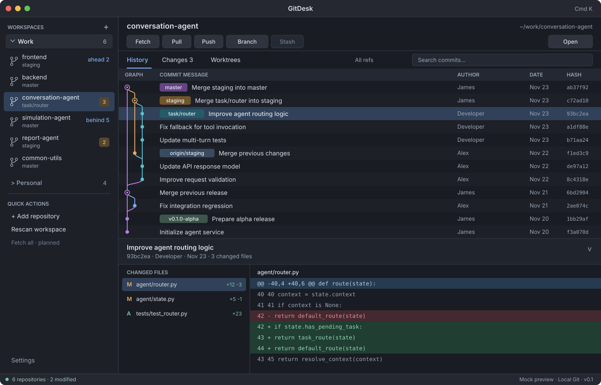

# GitDesk

> 面向多仓库与 AI Coding 工作流的轻量级 Git 可视化桌面应用。

macOS 桌面端已有真实提交图、提交详情、文件 Diff、工作区改动、发布流转追踪和需要手动确认的 Git 操作，可在本地试用。首发目标为 macOS（Apple Silicon 优先），采用 Tauri 2 + React + TypeScript + Rust。项目名暂定 GitDesk，发布前再检查命名冲突。计划采用 MIT 许可，版权署名与许可证由所有者确认。

GitDesk 是 Orca、Codex、Claude Code 等开发工具的伴侣，而非另一个 IDE。它直接读取本地 Git 仓库，无需迁移或重新 clone，无需账号、云服务、数据库或内置 AI。

## 设计文档导航

| 文件 | 作用 |
| --- | --- |
| [`AGENTS.md`](AGENTS.md) | Codex 在仓库内必须遵守的开发规则、质量标准与边界 |
| [`docs/CODEX_START.md`](docs/CODEX_START.md) | M1 启动提示词和后续任务模板 |
| [`docs/PRODUCT.md`](docs/PRODUCT.md) | 产品定位、功能范围、关键流程与版本验收 |
| [`docs/ARCHITECTURE.md`](docs/ARCHITECTURE.md) | 技术架构、IPC 契约、Git CLI、并发与安全 |
| [`docs/DESIGN_SYSTEM.md`](docs/DESIGN_SYSTEM.md) | 视觉规范、布局、组件、交互、macOS 体验 |
| [`docs/GRAPH_ALGORITHM.md`](docs/GRAPH_ALGORITHM.md) | DAG 布局、轨道算法、分页、渲染与测试 |
| [`docs/RELEASE_TRACKING.md`](docs/RELEASE_TRACKING.md) | 发布流转追踪，按提交核对测试、预生产和正式目标分支 |
| [`docs/ROADMAP.md`](docs/ROADMAP.md) | 可逐阶段交付的 M1–M6 开发任务 |
| [界面参考稿（SVG）](docs/gitdesk-mockup.svg) · [设计预览（PNG）](docs/GitDesk-UI-preview.png) | 使用虚构数据的界面设计稿 |
| [M1 实际界面（PNG）](docs/GitDesk-M1-preview.png) | 浅色主题原型截图，1280 × 820 @2x |

## macOS 安装

安装包适用于 Apple Silicon Mac。在 Finder 打开 DMG，将 **GitDesk.app** 拖到 **Applications**。下载入口见 [GitHub Releases](https://github.com/moshangsang24/GitDesk/releases)。

以下命令从源码构建本地安装包，使用临时签名（ad hoc）。产物位于 `src-tauri/target/release/bundle/dmg/`。

```bash
CI=true pnpm tauri build --bundles app,dmg --config '{"bundle":{"active":true,"macOS":{"signingIdentity":"-"}}}'
```

## 运行 GitDesk

在项目根目录使用 Node.js 24.15 或更高版本和 pnpm 12.4.1。已有对应 nvm 工具链时，可先执行 `nvm use`。

```bash
pnpm install --frozen-lockfile
pnpm tauri dev
```

原生构建需要 Rust stable 和 Xcode Command Line Tools。桌面窗口通过 **Add workspace** 打开你选中的目录。 [Tauri 前置条件](https://v2.tauri.app/start/prerequisites/)

### M5 分支和同步验收

1. 用临时工作区和本地 bare remote 测试。点工具栏的当前分支，选择 **Create local branch**，确认基准提交。创建完成后再次打开分支选择器，用 **Switch existing** 切到新分支。
2. 点 **Fetch**，选择远程并确认。检查远程跟踪引用、ahead/behind 和 **Releases** 里的 Fetch 时间。让测试远程暂时不可达再试一次，已有比例应保留并标记 **Stale**。
3. 在配置了 upstream 的干净 worktree 中分别验证 **Pull** 和 **Push**。确认页列出 worktree、目标与远程主机。Pull 仅允许快进，Push 将确认的提交发到 upstream。构造分叉后，两项操作均拒绝改写现有提交。工具栏的历史图标可查看本会话最近 20 条操作结果。
4. **Settings → Network** 为当前仓库选择 **Use Git settings**、**Direct (no proxy)** 或 **Custom proxy**。配置适用于该仓库的 HTTP(S) Fetch、Pull 和 Push，确认页显示生效的模式。内网可达时可选直连，外网仓库可选自己的代理。

### M4 Diff 和发布流转验收

1. 在 **History** 点开合并提交，通过 **Compare parent** 比较两个父提交。选中文件后读取对应 Diff。哈希按钮复制完整提交 ID。
2. 在 **Changes** 检查 Staged、Unstaged、Untracked 和 Conflicts。已暂存且又有修改的文件会在两个区各显示一份比较。选中文件后滚动 Patch，再修改同一文件，核对预览更新时保留滚动位置。若清理过滤器影响判断，状态栏会提示。工具栏的文件夹按钮可打开当前 worktree 的 Finder 或 Terminal。
3. 在 **Settings → Release branches** 为当前仓库选 Test、Staging、Master。进入 **History → Compare release targets**，点击任一方向的数字查看差异并定位提交。切换 worktree，验证比较起点随之变化。
4. 用 **Releases → Add task → Review commits vs …** 查看以配置的 Master 为基线的候选。用 `fix/3704-poc` 验证标题和任务号自动填入。也可以在 History 选中提交后点 **Track as task**。点击阶段比例查看缺失项；如果目标上有 squash 提交，勾选原提交、粘贴目标完整 OID 并验证人工关联。切换 Test 后查看新结果及旧目标的历史观察。
5. 在 History 的 **Show references** 菜单里勾选 **Release status**，查看逐提交状态。Releases 使用本地引用快照，主动 Fetch 完成后刷新快照和证据。[发布流转追踪](docs/RELEASE_TRACKING.md)

### M3 提交图验收

1. 打开包含合并提交的本地仓库，选中 **History**。查看合并提交的圆环和两条父线，滚动到首批末尾或点 **Load older**，确认轨道连续。
2. 展开 History 左侧的 **Local** 和 **Remote**，点分支定位提交。同一提交的本地和远程引用显示在同一行。通过右上角 **Show references** 切换两类引用，确认当前选中提交和合并线保留。缩到 980×600 时，引用面板默认收起，仍可从工具栏展开。
3. 用 **History scope** 比较 **All refs**、**Current branch** 和 **Local branches**。点分支旁的准星仅查看该分支的历史。用 `⌘F` 搜索提交，**Search older** 会继续查找后续页。
4. 在 **History scope → My branches** 选择提交记录里的作者姓名与邮箱，再确认基准分支。列表与图从基准分支之外包含该作者提交的分支开始，保留这些分支的完整可达历史。身份和基准按仓库保存，可用旁边的头像按钮修改。

### M2 本地仓库验收

1. 打开包含两个 Git 仓库的文件夹，确认左侧显示仓库。用各工作区标题旁的按钮重新扫描或移除该工作区，也可以从侧栏补加单个 Git 仓库。
2. 在 **Branches** 查看本地分支、远程跟踪分支和标签。在 **Worktrees** 选择关联目录，确认分支、修改计数和路径随浏览对象更新。
3. 打开两个仓库再切回第一个，查看 History 首屏的缓存内容和后台刷新。随后在临时仓库或 worktree 中新增文件，确认桌面窗口可见时修改计数自动更新。关闭并重开应用，确认恢复工作区和所选 worktree。

将鼠标移到仓库行，点右侧 **×** 可将它从该工作区移除。重新扫描会保留这项设置，仓库文件依然保留在磁盘上。要恢复显示，用该工作区旁的 **+** 重新选中仓库根目录。

桌面端使用本地 Git 查询。浏览器端可以单独运行 `pnpm dev` 查看 Mock 预览，地址为 [127.0.0.1:1420](http://127.0.0.1:1420/)。从单独运行的浏览器开发服务器切换到 `pnpm tauri dev` 时需要先释放这个端口。

### M1 浏览器原型验收

1. 在 `conversation-agent` 的 History 中选择 **Merge staging into master**，用 **Compare parent** 切换比较基准，查看文件列表和 Diff。
2. 在 Worktrees 里选择 `~/worktrees/conversation-staging`，再点 Changes，确认看到的是该 worktree 的 `config/staging.toml`。
3. 用 `⌘F` 搜索提交，用 `⌘K` 搜索仓库。Personal 下的 `empty-repo` 和 `archive-api` 分别演示空历史和加载失败。

外观默认跟随系统，可在 Settings → Appearance 选择浅色或深色。

浏览器原型使用确定性的模拟数据，提交图使用预设轨道及实际的模拟父提交关系。窗口底部显示 **Mock mode**，桌面窗口显示 **Local Git**。

```bash
pnpm lint && pnpm typecheck && pnpm test && pnpm build
cargo fmt --manifest-path src-tauri/Cargo.toml -- --check
cargo test --manifest-path src-tauri/Cargo.toml
pnpm tauri build --no-bundle
```

## 技术决策摘要

- TypeScript：React UI、应用状态、Git Graph 纯函数算法。
- Rust：本地 Git CLI、目录扫描、文件监听、任务管理、IPC。
- SVG + HTML + TanStack Virtual：提交图与高密度列表。
- JSON：仅保存应用配置；历史和状态先用内存缓存。
- 优先调用系统 Git，不实现 Git 协议；不允许任意命令执行 IPC。
- v0.1 不做 Force Push、丢弃修改、交互式 Rebase、冲突编辑器、远程平台集成、AI 功能。

## 视觉参考



界面稿使用虚构数据。交互和功能范围分别见[视觉与交互规范](docs/DESIGN_SYSTEM.md)和[产品需求](docs/PRODUCT.md)。

## 参考资料

- [Tauri 2 文档](https://v2.tauri.app/)
- [React](https://react.dev/)
- [TanStack Virtual](https://tanstack.com/virtual/latest)
- [Git 官方手册](https://git-scm.com/docs)
