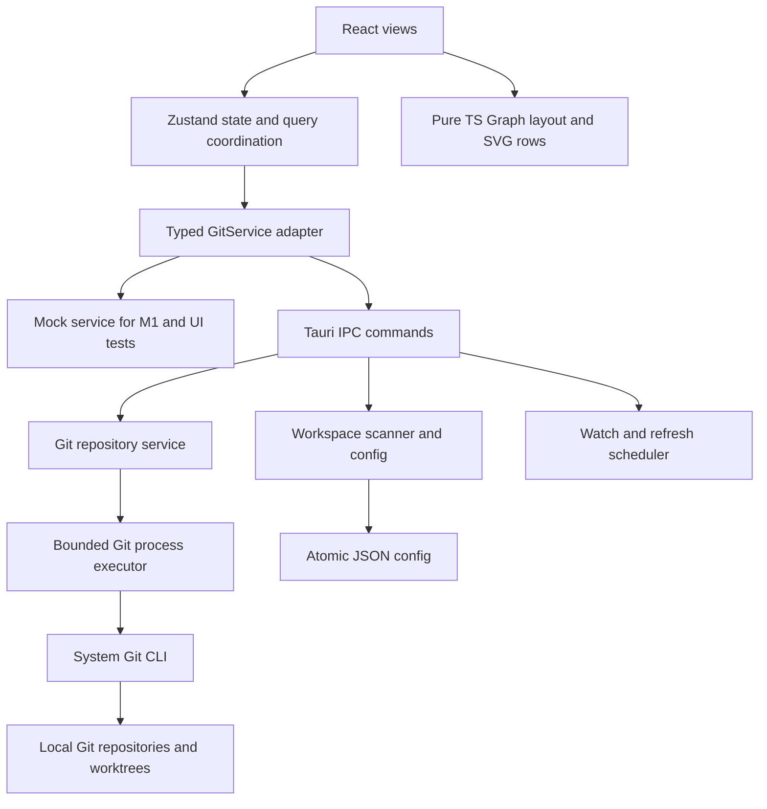

# GitDesk 技术架构

版本：v0.1 · 设计基线。功能范围以 [PRODUCT.md](PRODUCT.md) 为准。

## 1. 技术选型与原则

| 层 | 选择 | 说明 |
| --- | --- | --- |
| Desktop | Tauri 2 | macOS WKWebView、Rust 后端、系统窗口与打包 |
| Frontend | React + TypeScript（strict）+ Vite | 界面、业务状态、纯 TS Graph 算法 |
| UI | Tailwind CSS + CSS variables + Lucide React | 所有颜色与尺寸使用统一 design tokens |
| State | Zustand | workspace/selection/UI state；历史数据按会话缓存 |
| Rendering | TanStack Virtual + SVG + HTML | 固定行高、局部渲染、可测试的自定义布局 |
| Backend | Rust + Tokio + Serde + Notify | 异步 Git 进程、扫描、监听、结构化 IPC |
| Storage | JSON in application data directory | 原子写入、schema version；无数据库 |
| Git | 系统 Git CLI | 复用 Git、SSH、credential helper 与现有仓库 |
| Test | Vitest、Cargo test、真实 Git fixtures | E2E 首先在浏览器 mock 与 macOS 手工验收 |

使用维护中的兼容版本，不写死未经验证的最新版号；提交 pnpm-lock.yaml、Cargo.lock、明确 Node/Rust 要求。v0.1 无 HTTP 服务、Docker、Python runtime、libgit2、遥测或 AI SDK。Rust 不是另一个业务 UI 层，只处理系统边界和可靠性。



## 2. 工程目录

```text
gitdesk/
  AGENTS.md
  README.md
  docs/                        # 产品与技术基线
  src/
    app/                       # App shell, providers, keyboard shortcuts
    components/ui/             # button, menu, split pane, tooltip, badges
    components/layout/         # sidebar, toolbar, status bar
    features/
      workspace/
      history/
      changes/
      branches/
      worktrees/
      settings/
    core/graph/                # types.ts, layout.ts, lanes.ts, colors.ts, tests
    core/diff/                 # unified diff model and parser
    services/                  # contracts.ts, git.ts, mock.ts, tauri.ts
    stores/                    # workspace, selection, ui, history cache
    styles/                    # tokens.css, global.css
  src-tauri/
    capabilities/              # minimal permissions
    Cargo.toml
    src/
      lib.rs
      commands/                # thin typed IPC entrypoints
      git/                     # executor, history, refs, status, diff, operations
      workspace/               # scan, discovery, registry
      watcher/                 # fs events and debounce
      config/                  # migration, atomic save
      scheduler/               # concurrency limits and operation locks
  tests/fixtures/              # deterministic Git repo generators
  tests/integration/           # frontend adapter and end-to-end flows
```

模块独立；features 不直接调用 Tauri invoke，统一通过 GitService。纯算法不访问 DOM、IPC 或文件系统。Rust commands 不承载大量业务逻辑，只做输入校验和委派。先确定契约再并行开发；不因单一功能临时绕开 adapter。

## 3. 数据模型与 IPC 契约

以下类型是 M2/M3 的设计约定（不是已经生成的源码）。Rust DTO 使用 serde rename_all="camelCase"，TypeScript 对齐；枚举用 tagged union 或固定字符串，新增字段保持兼容。所有 OID 是完整字符串，不假定 SHA-1 固定 40 位。

```ts
export type RepoId = string;        // stable ID from canonical common dir
export type WorktreeId = string;    // stable ID from canonical worktree/git dir
export type Oid = string;
export type RequestId = string;
export type HistorySessionId = string;

export interface Workspace {
  id: string;
  name: string;
  rootPath: string;
  repositoryIds: RepoId[];
}
export interface Repository {
  id: RepoId;
  name: string;
  commonDir: string;
  primaryWorktreeId: WorktreeId | null;
  worktrees: Worktree[];
  bare: boolean;
}
export interface Worktree {
  id: WorktreeId;
  repoId: RepoId;
  path: string;
  head: Oid | null;
  branch: string | null; // fully qualified local ref or null
  locked: boolean;
  prunable: boolean;
}
export interface RepoStatus {
  worktreeId: WorktreeId;
  head: Oid | null;
  branch: string | null;
  upstream: string | null;
  ahead: number | null;
  behind: number | null;
  stagedCount: number;
  unstagedCount: number;
  untrackedCount: number;
  conflictCount: number;
  operation: 'none' | 'merge' | 'rebase' | 'cherryPick' | 'other' | 'unknown';
  observedAt: number;
}
export interface GitRef {
  fullName: string;
  kind: 'local' | 'remote' | 'tag' | 'head' | 'other';
  targetOid: Oid; // commit target after peeling; non-commit refs excluded from graph
  symbolicTarget?: string;
}
export interface Commit {
  oid: Oid;
  parents: Oid[];
  subject: string;
  authorName: string;
  authorTime: number; // Unix seconds
  shallowBoundary: boolean;
}
export type HistoryScope = 'all' | 'current' | 'local' | 'ref' | 'mine';
export interface HistoryRefVisibility {
  local: boolean;
  remote: boolean;
}
export interface HistoryPage {
  sequence: number;
  commits: Commit[];
  hasMore: boolean;
  truncated: boolean;
}
export interface GitError {
  code: 'NOT_REPO' | 'INVALID_INPUT' | 'GIT_NOT_FOUND' | 'UNSUPPORTED' |
        'AUTH_REQUIRED' | 'DIRTY' | 'CONFLICT' | 'BUSY' | 'STALE' |
        'CANCELLED' | 'TIMEOUT' | 'GIT_FAILED' | 'IO_ERROR';
  message: string;
  exitCode?: number;
  stderr?: string; // bounded, sanitized for UI; never include secrets
}
```

IPC command 名与输入保持明确、细粒度。所有路径型输入只用于用户主动选择目录、手动添加仓库或已注册 worktree；普通 Git 操作仅接受后端注册的 ID。路径不作为可自由指定的执行位置。

| Command | Input（概要） | Output / 行为 |
| --- | --- | --- |
| load_config / save_ui_preferences | typed settings | JSON config only |
| add_workspace / rescan_workspace | selected root / workspaceId, requestId | scan result + progress events |
| remove_workspace / add_repository | workspaceId / chosen directory | registry updates only, never delete disk |
| get_repository / list_worktrees | repoId | repository / worktrees |
| get_repository_snapshot | repoId, requestId | repository, worktree statuses and refs. Concurrent requests share an unfinished read. |
| list_refs | repoId, worktreeId | ref snapshot |
| open_history | sessionId, repoId, worktreeId, scope, optional refName or authorFilter | frozen refs, matching branch names for My branches, HEAD, shallow stamp, first page |
| list_commit_authors | repoId, requestId | unique author identities from up to 5,000 recent local and remote-tracking branch commits |
| load_history_page | sessionId, sequence | next page, rejects stale or duplicate requests |
| close_history | sessionId | cancel reads and release resources |
| get_commit_detail | repoId, oid, parentOid, requestId | message, committer, changed files and numstat |
| list_worktree_changes | repoId, worktreeId, requestId | staged, unstaged, untracked and conflict file lists |
| get_file_preview | repoId, worktreeId, commit or changes source, fileId, requestId | bounded structured patch for a verified file |
| cancel_review | requestId | cancel snapshot, file or release reads |
| get_release_overview / save_release_targets | repoId, target refs and expected version for save | repository release profile and tasks |
| save_release_task / delete_release_task | repoId, task ID, expected version, optional edited fields | local release task configuration |
| release_candidates / evaluate_release / list_release_observations | repoId, requested range or commit set, task and target versions as applicable | candidate commits, current proof or saved observations |
| list_operation_remotes | repository and worktree IDs | configured names |
| prepare_git_operation | operation ID, repository and worktree IDs, expected state, typed action | validated confirmation backed by a single-use plan |
| execute_git_operation / cancel_git_operation | operation ID | revalidate and execute the plan, or revoke the plan or cancel an active Fetch |
| get_fetch_activity | repository ID | last successful explicit Fetch and latest failure per remote |
| open_worktree_location | repoId, registered worktreeId, Finder or Terminal | fixed native application opener |
```

Frontend adapter must expose equivalent mock and real methods. M1 mock uses deterministic latency and failure scenarios; do not silently fall back to mock when real Git fails. Dev indicator may show Mock mode; release does not include a switch that pretends to operate on actual repos.

Events: `workspace-scan-progress`, `repository-invalidated`, `git-operation-progress`. Each payload contains relevant IDs, requestId/generation, bounded message, optional progress (indeterminate when unavailable). Never treat event arrival as success; final typed operation result is authoritative.

## 4. Git discovery and command execution

M2 通过桌面端原生目录选择器授权扫描，前端用 `load_workspace`、`get_repository_snapshot`、`save_workspace_selection` 等类型化命令读取工作区。原生适配器和浏览器 Mock 共用视图契约。扫描进度由 IPC Channel 返回，文件变更通过 `repository-invalidated` 发给选中的窗口。

### 4.1 Git executable

Resolve once and validate by `git --version` (support capability checks, not guessed minimum version). Priority: user-configured absolute executable → known trusted install locations including `/opt/homebrew/bin/git`, `/usr/local/bin/git`, `/usr/bin/git` → controlled PATH lookup. If macOS system Git requires Xcode CLI tools, show installation instructions. Finder launch PATH may differ from Terminal. Avoid spawning login shell or evaluating shell profiles. Keep needed HOME, SSH_AUTH_SOCK, credential helpers, PATH for subprocesses; clear inherited repository-specific overrides such as GIT_DIR/GIT_WORK_TREE/GIT_INDEX_FILE and unsafe app-specific overrides. Never log full env or credential-bearing URLs.

### 4.2 Workspace discovery

Use bounded worker pool (initially 2 scan workers / 4 background reads; configurable internal defaults) and cancellable traversal. Skip `.git` internals, node_modules, build caches, .venv, configurable ignored directories; do not follow symlinks by default. Recognize `.git` file and directory, and explicit bare repository selected by user. Nested independent repos/submodules may be registered if discovered under selected root; document that scan depth/ignore settings affect results, avoid traversing large generated dirs. Canonicalize and deduplicate paths. Never scan all HOME automatically.

M2 单次扫描最多遍历 12 层、250,000 个条目和 2,000 个 Git 根目录；跳过 `.git`、`node_modules`、`.venv`、`target`、`dist` 等目录。达到上限或遇到不可读路径时，显示提示并保留上次登记的仓库。短查询并发上限为 4，每条查询最多 12 秒和 4 MiB stdout。History 分页有独立进程槽。读取禁用可选锁、fsmonitor 和网络协议，界面仅显示结构化错误。

```bash
git -C "$directory" rev-parse --show-toplevel
git -C "$directory" rev-parse --absolute-git-dir
git -C "$directory" rev-parse --path-format=absolute --git-common-dir
git -C "$directory" rev-parse --is-bare-repository
git -C "$directory" worktree list --porcelain -z
```

Commands here illustrate CLI semantics only; Rust passes individual `OsString` arguments without shell. If path-format unsupported, use explicit canonicalization fallback verified for relative paths or show unsupported. Use native `PathBuf` for filesystem paths; JSON carries display strings and opaque IDs. Non-UTF-8 path handling must be lossless at backend; if unavailable in v0.1, flag as unsupported rather than using lossy path for writes.

### 4.3 Status and refs

```bash
git -C "$worktree" status --porcelain=v2 --branch -z
git -C "$worktree" worktree list --porcelain -z
git -C "$worktree" for-each-ref --format='%(refname)%00%(objectname)%00%(objecttype)%00%(*objectname)%00%(*objecttype)%00%(symref)'
git -C "$worktree" rev-parse --verify HEAD
```

Parse status as bytes/NUL-separated records (rename has extra path; unmerged record distinct; branch.oid `(initial)` means no commits). Preserve exact path identity in backend. Use the type-specific parser for for-each-ref: NUL field separator within LF-separated records. Peel annotated tags to commit target, skip non-commit targets and names with invalid UTF-8, handle symbolic remote HEAD as alias, and avoid duplicated HEAD badges. A worktree whose branch name cannot be displayed keeps its HEAD commit available for browsing. Include selected worktree detached HEAD in all-history roots. Other detached worktree tips may optionally appear as explicitly labeled roots; ensure scope definition and labels agree. Derive merge/rebase/cherry-pick state from worktree-specific git paths (`git rev-parse --git-path ...`) rather than assuming `.git` is a directory.

### 4.4 History session

Build a deduplicated list of commit OIDs from the selected history scope. `all` uses the ref snapshot and the selected worktree HEAD. `current` uses the selected worktree HEAD. `local` uses the targets of `refs/heads/*` from the snapshot. `ref` uses the exact selected ref's target in the snapshot. Handle empty roots without invoking an unconstrained `git log`. Freeze the ordered root list and ref decorations in a session. Run one async log process with roots (validated full object IDs) on stdin, and parse incremental records from stdout:

```bash
# Example: ROOTS contains one full commit OID per line, no arbitrary input.
printf '%s\n' "$ROOTS" | git -C "$worktree" --no-pager log \
  --topo-order --stdin -z --format='%H%x00%P%x00%an%x00%at%x00%s' --
```

Use `-z` with fixed arity, including empty parent and subject fields. The stream parser accepts chunk boundaries within fields and uses Git UTF-8 output encoding for display. The history command disables replace refs and grafts and checks the shallow metadata to distinguish shallow boundaries from roots.

Read 500 commits per page with one-record lookahead and a 4 MiB read limit. A session is capped at 100,000 commits and its stream closes after five idle minutes. The desktop keeps one History session. Opening another cancels the previous stream, including one left behind by a WebView reload. The stream has a dedicated process slot and exits on cancellation or timeout. Ref, HEAD or shallow changes mark the loaded history stale and offer refresh. Search and reference jumps use existing rows and load more from the same stream in batches. See [GRAPH_ALGORITHM.md](GRAPH_ALGORITHM.md).

`mine` compares the frozen local and remote-tracking tips against a verified base ref. A bounded reverse topological walk visits parents first and propagates matches for the selected raw author name/email to descendant tips. The matching tips become roots for normal history paging. Shallow history and incomplete scans show an error. The identity and base branch are local per-repository view preferences.

### 4.5 Commit and diff

- Commit metadata: `git show -s --format=... <oid> --`, using fixed formats and bounded output. Preserve message, author/committer, full parent OIDs.
- Commit file list: `git diff-tree --no-commit-id -r --name-status -z -M <parent> <oid> --` and `--numstat -z`; root uses `--root` and one commit. For merge require selected parent; default first parent. Validate selected parent belongs to commit. Use rename detection with limits, match file IDs rather than ambiguous text.
- Diff: `git diff --no-ext-diff --no-textconv --no-color <parent> <oid> -- <paths>`; root via `git show --format= --no-ext-diff --no-textconv --no-color <oid> -- <paths>`; use literal pathspec (`--literal-pathspecs` global option). For rename include old+new path. Disable external diff/textconv execution. Worktree staged/unstaged queries use `git diff --cached` / `git diff`; untracked file preview bounded and permission-checked. Never follow a working-tree symlink to read unrelated files; show symlink metadata instead.
- Set output limits (initial 1 MiB for a selected text patch, configurable internally), show truncation explicitly; large/binary file fallback metadata. Distinguish no diff from error and truncation. Render text as escaped text, not HTML.

### 4.6 Release evidence

通过仓库注册表解析 `RepoId` 和已验证的远程跟踪 ref，使用后端确认的完整 commit OID 执行 ancestry 查询。共享执行器返回 Git 退出码，发布检查区分 `merge-base --is-ancestor` 的成功、否定及失败。执行器关闭 replace refs、grafts、lazy fetch 和网络协议。浅克隆或部分克隆中的否定结果视为未知。

Release 查询独立于 History session，绑定仓库、请求、目标配置版本、任务版本及 OID 集。按阶段冻结 tip 并复核。后台任务低优先级、可取消，应用只读刷新也会重新计算。History 的本地/远程引用显示、范围和页大小只影响界面需要请求哪些 OID。发布配置、候选、任务及证据通过类型化 GitService/IPC 暴露。数据契约见 [发布流转追踪](RELEASE_TRACKING.md)。

## 5. State, caching, freshness

Logical repository cache stores history by session and frozen ref set; worktree cache stores local status by WorktreeId. Selection store uses `{workspaceId, repoId, worktreeId, page}` and per-repo view settings. History selection uses stable full commit OID. On switch, generate requestId and discard responses that do not match selection/generation; no stale data presented as current.

M3 将 `HistoryRefVisibility` 保存在 `RepoId` 对应的视图设置中，两项缺省值都为 `true`。开关作用于冻结引用在列表和 Branch / Tag 列中的呈现，沿用现有会话和轨道状态。历史范围作为独立的 `open_history` 输入，切换时生成新会话。定位引用使用冻结的目标 OID，按当前会话的分页顺序查找。

Filesystem watcher monitors selected worktree directory (excluding generated/cache paths where feasible), its git dir and shared common-dir changes. Debounce around 300–500 ms; events are invalidation hints, not truth. Worktree path may be deleted/replaced. Revalidate registration before writes. Use foreground status refresh on focus/manual action, low-frequency background repo status (e.g. every 30–60 s while focused, bounded and paused when hidden); no automatic network fetch v0.1. On watcher overflow or permission failure fallback to manual/low-frequency refresh. Snapshot reads can be cancelled. The frontend schedules a single follow-up read per repository when an invalidation or manual refresh arrives during a read. A silent recovery starts History if it has no session. File previews keep their current patch and scroll position during refresh. The selected file's revision and comparison base determine when a new patch is needed.

Config v2 lives under the Tauri app config directory, with atomic file replacement. It stores workspace roots, registrations, repository exclusions, selection, optional Git path, release metadata and Fetch records by remote. Configuration headers are parsed before version-specific data. An unsupported version leaves the original file in place and makes settings read-only. Corrupt supported configurations are backed up before recovery. Appearance and repository view settings live in the local WebView.

当前 `workspaces.json` 保存授权目录、注册路径、可选 Git 路径和最后选中的仓库、worktree、页面。外观和工作区展开偏好保存在本机 WebView。选中 worktree 的变更事件约 425ms 合并一次，窗口可见时每 45 秒刷新当前仓库并轮询最多四个其他仓库。

首次保存时将旧版 `workspaces.json` 迁移到 v2。迁移保留扫描根目录、手动添加及移除记录、Git 路径和现有选择。发布目标默认未配置，按逻辑仓库保存。任务修订和历史观察使用有界本地元数据并原子保存。选中的提交和比较基准按仓库及 worktree 保存，History 首屏包含该提交时恢复详情。

## 6. Safe operations and concurrency

Rust process executor uses `Command` args, `current_dir` / `git -C`, no `sh -c`, no arbitrary command IPC. Validate OIDs/ref names (`git check-ref-format --branch` and reject shorthand like `@{-1}` if accepting names), confirm exact target from registry, use `--` / appropriate argument separators and literal pathspec. Use process timeout, output cap, cancellation and redacted errors. Network operations can take longer than read requests; show actual busy status. Do not cancel a write mid-flight casually; if forced interruption occurs, mark state unknown and refresh before another write. Avoid disabling user Git hooks; explain that trusted repository/config can execute normal Git hooks and credential helpers, and only open trusted workspaces.

GitDesk serializes writes across all worktrees of a logical repository and returns Busy for overlapping confirmations. Confirmed plans expire after two minutes and can be used once. Reads and writes have separate concurrency limits. Locks cannot protect against external Orca/CLI processes; check state immediately before writes, rely on Git lock/ref updates, fail safely, refresh afterwards. Never delete `.lock` files. Revalidate expected HEAD, branch, upstream and working state at execution time; stale UI -> reject and ask retry. This mitigates but cannot eliminate TOCTOU with external processes.

| Operation | v0.1 behavior |
| --- | --- |
| Fetch | Explicit configured remote. Validate branch refspecs and constrain destinations to its tracking namespace. Use atomic ref updates and disable pruning, automatic tags, submodule recursion and auto-maintenance. |
| Pull | Clean worktree and valid upstream. Fetch that branch into its tracking ref, revalidate the worktree and upstream, verify ancestry and run `git merge --ff-only` against the fetched OID. Disable autostash, implicit submodule recursion and ignored-file overwrite. |
| Push | Ordinary `git push --no-follow-tags <remote> <confirmed-oid>:<remote-branch-ref>` after upstream verification. Reject mirror remotes, multiple push destinations and tracking mappings outside the remote namespace. |
| Create branch | validate unique local name and base OID; `git branch <name> <oid>`; no `-f`; creation need not checkout |
| Switch branch | only existing local ref; clean worktree, no in-progress operation; use explicit `git switch --no-guess --no-overwrite-ignore <name>`; Git detects branch occupied by another worktree |
| Worktree | list/select/open only; no add/remove/prune |

Read-only status and working diff skip submodule working-file checks and disable configured clean filters. The write preflight checks initialized submodule worktrees individually with the same filter restrictions. Changes that may depend on a filter are flagged as uncertain.

Authentication uses the existing trusted SSH agent and configured Git credential helper. Do not ask for/store tokens or passwords in v0.1. Set GIT_TERMINAL_PROMPT=0 for noninteractive background child, catch interactive authentication requirements and direct users to Terminal. Never embed secrets in args, error UI, config or logs. The executor classifies bounded Git diagnostics and returns fixed error messages with exit codes. The UI shows the operation target and the remote host with URL credentials and paths omitted. The session log retains up to 20 results per repository. Explicit Fetch can be cancelled, and interruption refreshes observed state after Git exits.

## 7. Permissions and platform

Minimal Tauri capabilities: typed IPC and approved dialog/open actions; no generic shell plugin permission, no frontend filesystem write or HTTP plugin. Block remote WebView navigation, use local assets/CSP (no arbitrary HTML from repository content). Restrict external opener to registered local path or fixed trusted documentation URL. No admin/root execution. Ensure dependency lockfiles and review dangerous changes. Build local arm64 app first; decide Intel/universal only after testing. Release signing/notarization is a separate distribution task, not assumed complete.

## 8. Testing

Unit: parser fixtures for NUL/renames, non-ASCII, detached and unborn; history chunk boundaries and cancellation; graph deterministic topology; config migration, command argument construction and redaction. Integration: temp repo with deterministic author/clock, merge, multiple worktrees, empty and bare repo, local bare remote (no real credentials/network); verify state and refs before and after operations; test dirty/diverged/no-upstream/branch-in-other-worktree cases. Frontend: adapter mock, keyboard flow, stale results, virtual list selection. Performance: generate synthetic 100k commits or use approved local repos; do not benchmark on user workspaces with write tests.
