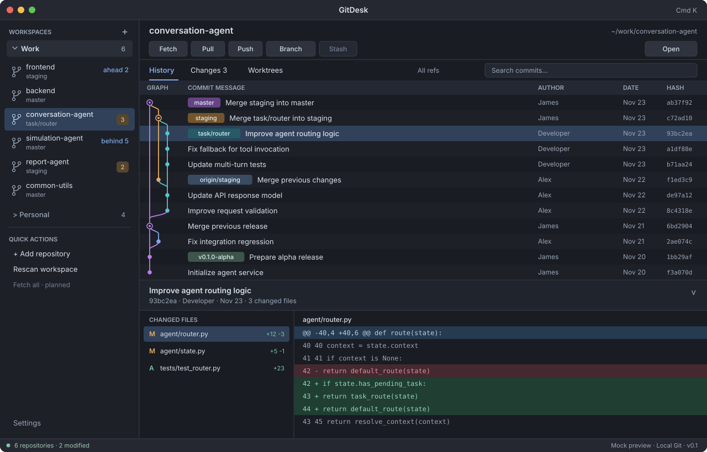

# GitDesk 视觉与交互规范

版本 v0.1 · macOS Git 工作台



示意图记录初始构图。M1 评审后的视觉层级、尺寸和交互以本文为准。目标是高密度、克制的原生桌面工具。

## 1. 主窗口结构

建议默认窗口 1280 × 820 logical px；最小 980 × 600（以真实 macOS 验证）。允许最大化与系统缩放。窗口使用 macOS 标准交通灯控件（不要自己仿造可点击按钮）；可采用 Tauri titleBarStyle overlay，在真实系统验证拖拽区和交通灯 safe area。浏览器 Mock 只模拟视觉。单一主窗口，详情不跳出新窗口。

```text
┌─────────────────────────────────────────────────────────────────────┐
│ macOS title bar             GitDesk                         ⌘ K    │
├──────────────────┬──────────────────────────────────────────────────┤
│ WORKSPACES   +   │ conversation-agent · task/router · ~/work/...  │
│ ▼ Work           │                       [Fetch | Pull | Push]    │
│   frontend       ├──────────────────────────────────────────────────┤
│   staging        │ History    Changes    Worktrees    All refs  ⌕ │
│   backend        ├───────────┬─────────────────────────┬────────────┤
│   master         │ GRAPH     │ COMMIT MESSAGE          │ AUTHOR DATE│
│ ▸ conversation   │ ●╮        │ master   Merge staging  │ ...        │
│   task/router  3 │ │●╮       │ staging  Merge task     │ ...        │
│   simulation     │ ││●       │ Improve routing         │ ...        │
│   report-agent   │ ││●       │ Update tests            │ ...        │
│   common-utils   │ ●╯        │ Previous release        │ ...        │
│ ▶ Personal       ├───────────┴─────────────────────────┴────────────┤
│                  │ Commit detail: message · hash · author          │
│                  ├──────────────────────┬───────────────────────────┤
│                  │ Modified files       │ Unified diff              │
│ Refresh repo     │ M agent/router.py    │ - previous line           │
│ Settings         │ A tests/test.py      │ + new line                │
├──────────────────┴──────────────────────┴───────────────────────────┤
│ ● 6 repositories · 2 modified                            Git v…    │
└─────────────────────────────────────────────────────────────────────┘
```

| 区域 | 默认规格 | 行为 |
| --- | --- | --- |
| Title bar | 36 px | 系统窗口操作与标题；仅空白可拖拽 |
| Sidebar | 252 px，范围 200–360 px | 可调宽、可折叠；仓库项双行 42 px |
| Toolbar | 44 px | 单行显示仓库、当前分支和路径。右侧是同步操作组和目录入口 |
| Tabs/filters | 34 px | History / Changes / Worktrees。History 提供历史范围、显示引用和搜索，搜索组约 240 px |
| History header | 26 px | 列头固定，和列表横向滚动对齐。提交图宽随轨道数增长，宽屏限制标题与元数据的距离 |
| Commit row | 28 px | 固定行高，信息密集、虚拟化 |
| Detail panel | 约主区域 31%，最小 150 px | 1280×820 默认约 236 px。顶部用一行容纳标题、元数据和比较基准 |
| File/diff divider | 文件列默认 220 px，范围 160–340 px | 可拖拽调整，文件名用省略号和 tooltip |
| Status bar | 24 px | 当前扫描/仓库/同步状态、版本或 Git 诊断 |

所有尺寸是 CSS logical px；Retina 下仍清晰。优先在 1280×820 和 1440×900 适配，980×600 时允许压缩次要文字、横向滚动而非挤压 graph 线。长仓库名、分支名和文件路径使用 ellipsis + tooltip，不让布局跳动。保持至少一处可见的当前仓库与 worktree 路径。

## 2. Design tokens

两套主题共享 `src/styles/tokens.css` 的语义 token。Settings 的 Appearance 提供 System / Light / Dark，默认 System，跟随 macOS 外观并在系统切换时实时更新。Accent color 提供 Blue（默认）、Violet、Teal、Rose 四种强调色，通过根元素的 `data-accent` 覆盖 `--accent`、`--bg-selected`、`--accent-gradient` 和窗口色彩底的主色调；每种强调色在浅色和深色下都满足 WCAG AA。应用在本地保存选择。

视觉风格为“玻璃”：窗口底层是一层柔和的色彩底（`--window-wash`，左上蓝、左下紫、右上青），标题栏、侧栏和状态栏半透明地叠在上面；仓库内容是一张浮在上面的 12px 圆角卡片，带细描边和柔和阴影。卡片内部仍用底色而不是线条建立层次：提交详情头部、文件列表和引用区使用面板色。渐变只用于窗口色彩底、选中行的强调色渐隐和激活 tab 的下划线，不用于内容区背景、按钮或文字。

当前以实色模拟玻璃（色彩底 + 半透明层），不开启透明窗口。真实的系统毛玻璃（透出桌面壁纸）需要 Tauri 的 macOS 私有 API，会影响上架 Mac App Store，开启前需产品确认并在真机验证拖拽区、交通灯与性能。

| Token | 浅色 | 深色 | 用途 |
| --- | --- | --- | --- |
| --bg-window | #E3E8F1 | #111319 | 窗口底色，叠加 `--window-wash` 色彩底 |
| --glass | 白 36% | #181B23 35% | 侧栏半透明层（标题栏、状态栏透明） |
| --sidebar-selected | 白 82% | 白 9% | 侧栏选中项胶囊 |
| --card-shadow | — | — | 浮动内容卡片的描边与阴影 |
| --accent-gradient | #4F7CFF→#A96CF0 | #7FA8FF→#C08CFF | 激活 tab 下划线 |
| --bg-chrome | #E6EAF0 | #15171C | 浏览器标题栏颜色（theme-color） |
| --bg-sidebar | #ECEFF4 | #17191E | 工作区侧栏 |
| --bg-main | #FFFFFF | #1D2026 | 主内容、graph、diff 背景 |
| --bg-row-alt | #F8F9FB | #1A1D23 | 提交表隔行底色 |
| --bg-panel | #F7F9FB | #22252C | 详情头部、文件列表、引用区 |
| --bg-elevated | #EDF1F6 | #262A31 | 表头、菜单、浮层 |
| --bg-control | #E7ECF3 | #2E333D | 控件、二级按钮 |
| --bg-hover | #EEF2F8 | #262A32 | 行 hover |
| --bg-selected | #DCE7FB | #26375A | 焦点所在面板的选中项 |
| --bg-selected-inactive | #E6E9EF | #2A2E36 | 失焦面板的选中项 |
| --selection-indicator | #8A99AD | #596675 | 失焦选中项的左侧线 |
| --border | #C3CDD9 | #363B45 | 控件边框 |
| --border-subtle | #E1E6ED | #2B2F37 | 面板分隔线 |
| --text-primary | #182434 | #E3E8F0 | 正文、commit message |
| --text-secondary | #43536A | #A3AEBE | 次要信息 |
| --text-muted | #56667B | #97A2B4 | 路径、元数据（注意对比度） |
| --accent | #2858C8 | #7FA8FF | 焦点选中、焦点环、激活 tab、菜单高亮 |
| --success | #216848 | #7DC7A4 | clean/sync/新增 |
| --warning | #88520E | #E5AA65 | modified/需要注意 |
| --danger | #A13B4E | #EB98A0 | conflict/错误/删除差异 |
| --diff-add-bg | #EAF6EE | #1C3327 | 新增行背景 |
| --diff-del-bg | #FAECEF | #3A2229 | 删除行背景 |

提交图在两套主题中使用相同的 8 色轨道色序（purple、amber、cyan、blue、green、pink、yellow、indigo）。浅色主题取更深、更饱和的一组（如 #8B3FD9、#C2650A、#0A8FA0、#2F6FE0），2px 线条在白底上对比度不低于 3:1；深色主题取更亮的一组。文字与底色组合保持 WCAG AA（4.5:1）以上。提交图是画面的视觉主角，强调色只用于焦点与选中，其余界面保持中性。状态同时使用图标、文字和形状。

字体：`-apple-system, BlinkMacSystemFont, 'SF Pro Text', system-ui, sans-serif`；代码用 `ui-monospace, SFMono-Regular, Menlo, monospace`。默认 13px，重要标题 14px/600，次要 11–12px，组标签 10–11px/600，diff 12px/1.55。常规使用 400/500/600，避免到处粗体。常规间距 4/8/12/16 px；控件圆角 7 px，分支标签为胶囊；仅主内容区是 12px 圆角浮动卡片，内部面板不再嵌套卡片，面板分隔线 1px。图标 Lucide 14–16px，stroke 1.5–1.8，文本标签优先于猜图标。

## 3. 组件行为

### Workspace sidebar

侧栏半透明叠在窗口色彩底上；选中仓库是白色半透明胶囊（深色为浅色半透明），侧栏获得焦点时胶囊加一圈强调色描边。组标题用无底色的小号次要文字，展示展开/折叠和仓库数量。仓库行左侧保留分支图标，中间显示名称和分支，右侧用统一的小胶囊显示 `↑2`、`↓5`、`●3` 或 `!2`。颜色只强调符号，tooltip 和无障碍标签提供完整状态。Clean 留空，状态未知用 `–`。顶部可按仓库名或路径搜索，添加、刷新和 Settings 放在底部。Refresh repository 和 ⌘R 刷新当前仓库。仓库右键菜单包含 Refresh、Reveal in Finder、Open in Terminal 和 Remove from Workspace（移除应用记录）。

### 面板焦点

History 默认承担视觉焦点。焦点进入仓库列表、提交列表、文件列表或 worktree 表格时，该面板的选中项使用蓝底和 2px 高亮线。其他面板用灰底和低对比度的 2px 线保留选中位置。键盘焦点仍有独立的可见轮廓。

### Toolbar and tabs

单行工具栏左侧依次放仓库名、分支 chip 和当前 worktree 路径。右侧放 Fetch / Pull / Push 操作组和 Open 图标按钮。分支 chip 打开可搜索的本地分支列表，可创建和切换分支。分支操作及 Fetch / Pull / Push 都先展示 worktree 和目标，再由用户确认。工具栏提供本会话操作日志，运行中展示状态，Fetch 可取消。Mock 显示禁用理由，Stash 使用禁用按钮并标出 **Planned**。Open 提供固定 Finder / Terminal 操作。不可用按钮须解释具体原因。Tab 切换保持仓库和工作目录选择，History 切换 worktree 后重新验证 current scope。

### Commit history

History 的列顺序为 Branch / Tag、Graph、Commit Message、Author、Date、可选 Hash。分支与标签列靠近图形列，让引用和它所指向的提交对齐。Graph 按 [GRAPH_ALGORITHM.md](GRAPH_ALGORITHM.md) 绘制，最小约 48 px，按实际轨道数加宽。普通提交用实心点，合并提交用圆环和内点，根提交用方形，浅克隆边界用三角形。线宽 2px；节点半径约 4.3px，外加 2px 行底色描边，让节点从线上分离；选中提交的节点外加一圈强调色光晕。宽屏的留白放在元数据之后，列宽仍可调整。作者名前显示 16px 首字母头像，颜色由作者名哈希到轨道色，仅本地生成，不请求任何头像服务。7 天内的提交显示相对时间（如 `2h ago`、`Yesterday`），更早的显示短日期，tooltip 展示带时区的详细时间；Settings 可改为始终显示日期。日期、hash 和计数使用等宽数字。点击行打开提交详情，选择文件后显示 Diff。搜索保留完整拓扑，支持匹配高亮和上下定位。

#### 引用区与图上的标签

- 引用区和 Branches 页按分支名第一个 `/` 之前的前缀分组：两个及以上分支共用前缀时折叠为文件夹（显示数量），单个前缀的分支保持原名。包含当前检出分支的文件夹默认展开，其他默认收起；搜索时全部展开。当前检出的分支加粗并带强调色圆点。
- History 提供可折叠的引用区。仓库区域窄于 950 px 时默认收起引用区，工具栏按钮可手动展开。工作区侧栏用于切换仓库。引用区分 **Local、Remote、Tags、Worktrees**，分组标题显示数量。Remote 按 `origin`、`upstream` 等远程名再分组，支持搜索完整名称。Worktrees 条目用于切换查看对象。
- 图上的标签按 HEAD → 本地分支 → 远程跟踪分支 → tag 排列。标签颜色取所在提交节点的轨道色：淡色底 + 主文字色 + 类型标记，本地分支为实心圆点，远程跟踪分支为空心圆环，tag 为菱形，HEAD 为强调色空心圆（tooltip 与无障碍标签写明类型）。Branch / Tag 列常规为 162 px，提交表窄于 850 px 时收为 112 px，溢出显示可展开的 `+N`。`main` 和 `origin/main` 指向同一提交时同一行显示，指向不同提交时各自标在目标行上。领先、落后数量在已有上游和计数时显示。
- 单击分支或标签定位到它指向的提交，沿用当前历史范围。目标在范围内但尚未加载时，显示定位进度并按页查找。当前范围中找不到目标时，提供切换到 **All refs** 的入口。分支另有 **Focus branch** 操作，由用户显式触发。

#### 引用显示与历史范围

| 控件 | 行为 |
| --- | --- |
| **显示引用 → 本地分支** | 同时显示或隐藏引用区的 Local 组与图上的本地分支标签 |
| **显示引用 → 远程分支** | 同时显示或隐藏引用区的 Remote 组与图上的远程跟踪分支标签 |
| **历史范围 → All refs** | 展示全部引用和当前 HEAD 可达的提交 |
| **历史范围 → 当前分支** | 展示当前 worktree 的 HEAD 可达的提交 |
| **历史范围 → 仅本地分支** | 展示所有本地分支可达的提交 |
| **History scope → My branches** | 选择提交作者和基准分支后，展示基准之外包含该作者提交的本地或远程跟踪分支及其历史 |
| **Focus branch** | 展示所选分支可达的提交 |

两个引用显示开关可同时开启或关闭，默认均开启，按仓库保存。改变开关时保留当前历史会话、已加载行、轨道、合并线、滚动位置和选中提交。Tags 和 Worktrees 继续可见。当前 HEAD 的提交在历史范围内时，图中保留 HEAD 标注，工具栏始终显示所选 worktree 的分支或 HEAD。折叠单个分组只收起列表，切换历史范围会重新加载图。

第一次打开 **My branches** 时先选 Git 作者，列表显示姓名和邮箱，按任一字段搜索。基准默认建议仓库里的 `origin/HEAD` 指向的分支或常见的 `main` / `master`，可修改。虚拟列表显示可达历史，引用区和图上只显示匹配的本地及远程分支标签，沿用现有 Tags、Worktrees 和 HEAD 交互。头像按钮用于修改作者或基准，Branches 页提供同一选择入口。

### Detail and diff

详情顶部单行显示 subject、hash、作者、日期和变更文件数。subject 可展开完整 message。Merge 增加 parent 选择器，窄窗口优先保留标题、hash 和比较基准。文件列表保留 A/M/D/R/U 和 numstat，文件列表标题与当前文件名在同一高度。Diff 的 hunk 标题用中性色，行号槽用细线和代码分隔，新增与删除用低饱和度行底色、2px 色条和 `+` / `−` 同时标明。无差异、binary、too large、truncated 均有明确说明。仓库提供的 Diff 以转义文本显示。Changes 按 Staged / Unstaged / Untracked / Conflicts 分组，选择文件即可查看对应 Diff。

### 右键菜单

仓库行、提交行、分支与标签（图上标签和引用区）、文件行（提交详情与 Changes）、worktree 行提供右键菜单。桌面应用使用 macOS 原生菜单，浏览器 Mock 使用外观一致的 HTML 菜单；原生菜单不可用时退回 HTML 菜单。

| 位置 | 菜单项 |
| --- | --- |
| 仓库行 | 当前仓库为 Refresh（⌘R），其他仓库为 Open Repository · Reveal in Finder · Open in Terminal · Copy Path · Remove from Workspace…（只移除应用记录，先确认） |
| 提交行 | Copy Hash（⌘C）· Copy Short Hash · Copy Subject · 每个指向该提交的本地分支一项 Focus History on `<branch>`（最多 3 项） |
| 分支 / 标签 | Locate Commit · Focus History on This Branch（tag 无此项）· Copy Name |
| 文件行 | Show Diff · Copy Path · Copy Full Path（当前 worktree 路径 + 相对路径） |
| Worktree 行 | Browse This Worktree（正在查看时隐藏）· Reveal in Finder · Open in Terminal · Copy Path |

- 提交行和文件行右键时先选中该行（提交随即打开详情），菜单作用于选中对象。仓库行和 worktree 行右键不切换浏览对象（切换会重新加载），菜单直接作用于该行：Finder / Terminal 打开该行对应的 worktree（仓库行取当前查看或主 worktree）。
- 复制类操作完成后在窗口底部短暂提示 Copied …；失败时提示改用选中文字后 ⌘C。
- 菜单只放只读动作。Git 写操作在 M5 确认流程完成后另行加入，且必须经过确认对话框；reset、revert、cherry-pick 等 P1/P2 或被禁止的操作不出现在菜单中，也不放置灰占位。
- 不适用的项隐藏；暂时不可用的项置灰，并在文字中写明原因（如浏览器预览中的 `(Desktop App Only)`、worktree 丢失时的 `(Worktree Missing)`）。只显示真实可用的快捷键。
- Tauri 能力只增加 `core:menu:allow-new`、`core:menu:allow-popup` 和用于释放菜单资源的 `core:resources:allow-close`。
- 焦点所在行可用 ⇧F10 打开同一份菜单。选中提交且没有文字选区时，⌘C 复制完整 hash。
- 屏蔽 WebView 默认右键菜单；输入框、Diff 和提交说明等可选中文字区域保留系统的复制菜单。
- 单个文件的 Reveal in Finder 需要新增只读 IPC（沿用 registry 和 file id 校验），待后端排期后加入。

### Branches 与工作区状态

- 顶部状态条左侧是工作区：总改动胶囊（有改动为琥珀色，冲突为红色，干净为绿色），随后是 Staged（绿）、Unstaged（琥珀）、Untracked（青，`--status-untracked`）、Conflicts（红）四个带色点的计数，计数为 0 时淡化。右侧是同步：上游名称与 ↑ahead（强调色）/ ↓behind（琥珀）胶囊，或 Up to date / No upstream。Changes 页的分组标题使用同一套颜色。
- Branches 表格列为 Name、Tracking、Worktree、Commit 和悬停时出现的 Show in History。Tracking：当前分支显示真实上游与 ahead/behind；其他本地分支与同名的 `origin/<name>` 比较，显示 Same as / Differs from / Local only；远程分支显示是否有对应本地分支。Worktree 列显示检出该分支的 worktree。行支持右键菜单。
- 每个分支的最后提交时间、作者、标题以及非当前分支的 ahead/behind 计数需要后端在读取 refs 时提供，待后端排期后加入。

### Worktrees

使用列表或表格，不做大卡片。每行 branch/HEAD、绝对或缩短路径、dirty/sync 状态、locked/prunable、当前查看标记。关联目录在 workspace 外显示 external 标签。点击 Select 仅切换浏览上下文，Finder/Terminal 是显式操作。不得误用 checkout 来实现 UI 切换。

### Releases

- 在仓库 Tab 内使用现有的浅色和深色主题、紧凑表格和选中态。页首放 **Configure targets**、各阶段实际引用、本机观察时间及 GitDesk Fetch 时间。未配置时先提供目标配置入口。
- 任务表展示任务号或标题、来源分支、提交数、Test / Staging / Prod 的包含比例和最后观察时间。保留 **Add task**、搜索和阶段筛选。可筛选各阶段未完整包含、无法判断和已归档，阶段条件可重叠。点击阶段单元格展开逐提交证据与历史观察。
- 已包含、未包含、无法判断、计算中、未配置和过期均有可见文字或不同符号，悬停和键盘聚焦时可查看实际引用、tip、时间及具体原因。阶段名称放在列头，窄窗口保留名称和比例，长引用在详情中显示全名。
- 在 History 通过 **Show references → Release status** 打开 Test / Staging / Prod 列，默认关闭，偏好按仓库记忆。列宽 74 px，窄窗口沿用横向滚动。保持 28 px 行高，证据随可见行异步返回。详见 [证据与状态规则](RELEASE_TRACKING.md)。

## 4. 交互与快捷键

| Shortcut | Action |
| --- | --- |
| ⌘K | 打开仓库/命令快速切换（v0.1 优先仓库搜索；其余可后续） |
| ⌘F | 当前 History / Changes / Workspace 搜索 |
| ⌘R | 刷新当前仓库本地数据（不是 Fetch） |
| ↑ / ↓ | 当前聚焦列表的上一/下一行 |
| Enter | 查看选择的提交或仓库 |
| Esc | 关闭菜单、搜索或详情（按层级） |
| ⌘C | 提交列表聚焦且无文字选区时，复制选中提交的完整 hash |
| ⇧F10 | 打开焦点所在行的右键菜单 |
| ⌘, | Settings |

支持 macOS 标准复制/选中文字、可访问焦点、可见 focus ring、菜单键盘导航、禁用控件提示。列表焦点与文本编辑不冲突；快捷键不可在输入框中误触 Git 操作。鼠标 hover 不刷新数据，不因状态更新抢夺键盘焦点。分隔线 drag 命中区域建议 6–8px，视觉仍是 1px。

## 5. Loading / Error states

- 首次打开：清晰空状态，加 Workspace 按钮；扫描不阻塞整个窗口，可取消。
- 切换仓库：局部 skeleton，标明正在加载的仓库，不展示上一仓库的历史冒充当前。
- History empty：仓库尚无提交或筛选范围无 commit，不显示通用报错。
- Stale：低干扰顶部提示，Refresh；不要悄悄替换正在阅读的图。
- Git 操作：toolbar busy / progress；成功后刷新状态，错误提供可复制的脱敏 stderr；不把未知状态当成功。
- 路径丢失/权限不足：明确原因，提供重新定位或移除（仅配置）。
- 无法认证：提示使用 Terminal 配置现有 Git/SSH 凭据，不提供密码输入框。

## 6. M1 验收场景

必须提供浏览器可运行的 Mock UI，以及 macOS Tauri 窗口（如当前开发环境具备）。设计参考稿中的仓库/提交仅为虚构样例。至少六个仓库、两个 Workspace、三种状态、包含真实父关系的模拟 merge 图、20+ commit rows、commit diff、Changes、Worktrees、空/错误状态。所有显示控件都应真实可交互或明确禁用；无需真实 Git。提供截图或录屏记录并由项目所有者检查。先做静态结构再接 Mock 状态，禁止为完成界面临时写真实仓库操作。
